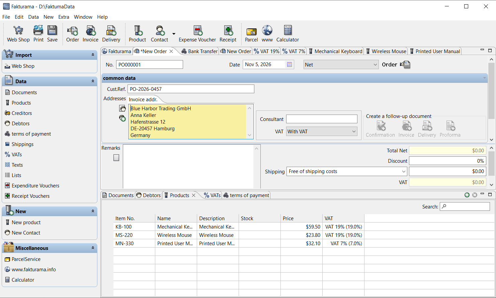
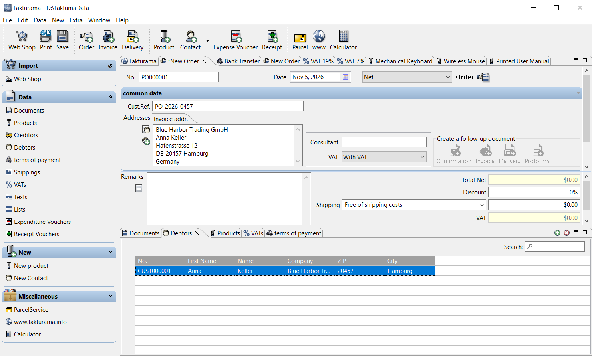
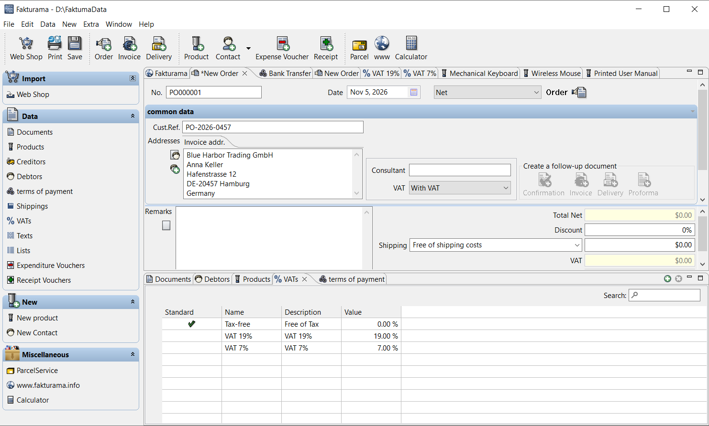
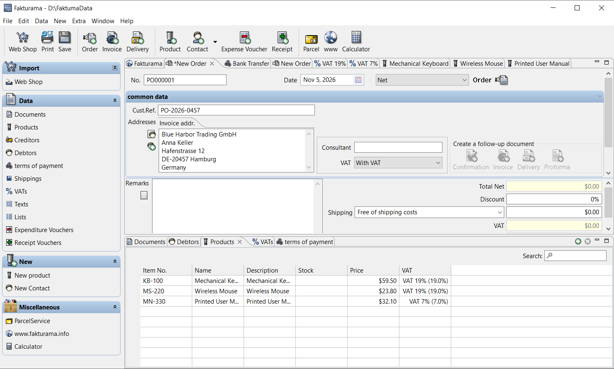
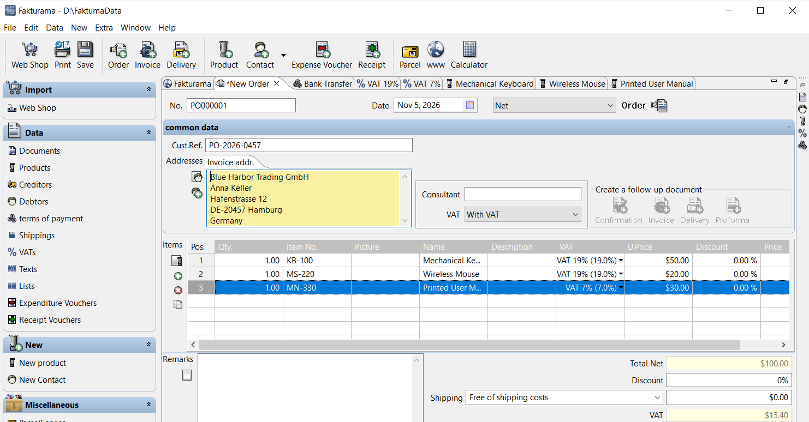

# Fakturama Image-to-Cash Automation

Take-home project for TJM Labs. A Python robot that reads an order image with a vision model, validates it, and drives the Fakturama desktop application through Microsoft UI Automation (UIA) to create the master data and the Order.

**This is a partial implementation.** The first half of the flow works and is verified on the real application; the second half (items table, saving the Order, the linked Invoice) is not built. Everything skipped is listed below, with the reason and the next step.

The Part 1 design document is in [docs/Design_Doc_Fakturama.docx](docs/Design_Doc_Fakturama.docx).

## Status

| Step | Status |
|---|---|
| Read the order image into JSON (Gemini vision, fixed schema, model fallback) | Done: matches the answer key on the task's example image and on my fake sample |
| Validate (line totals, sums, VAT, dates, payment rules), 15 unit tests | Done |
| Open a New Order, set date, Cust.Ref., price mode Net, check VAT mode | Done, verified on screen |
| Create payment method "Bank Transfer" | Done |
| Create the Debtor (company, contact, address, alias, Net, payment method) | Done, record reopened and every field compared |
| Select the Debtor in the Order (reads the dialog table, exact match, native row selection) | Done, Order's address box verified |
| Create VAT rates (VAT 19%, VAT 7%) | Done, checked in the VATs list |
| Create products (SKU, gross = net x (1 + VAT/100), cost 0, stock 0) | Done, checked in the Products list |
| Check before create: VAT entries and payment methods (reads the real dropdowns; reuses by name) | Done; the percentage of an existing entry is not compared |
| Check before create: products | **Not done**: re-running creates duplicate products |
| Add the products to the Order (type the SKU; verified by Total Net and the Items grid, offline OCR fallback) | Done: Total Net $100.00 and VAT $15.40 as expected |
| Set quantity and discount per line in the Items table | **Not started** (price and VAT already come with the product) |
| Save the Order and verify it in Data > Documents | **Not started** |
| Create the linked Invoice from the Order, set payment status, verify | **Not started** |
| One-command runner and run report | **Not started** (each step has its own script in `tools/`) |

## Screenshots (real runs, Fakturama window only, fake data)

**1. Order with header, selected debtor and the products created.** Date, Cust.Ref. and price mode Net were set by the bot and read back. The Address box was filled by selecting the debtor in the "Select the address" dialog and verified afterwards. The bottom panel lists the three products the bot created, with gross prices 59.50, 23.80 and 32.10.



**2. Debtors list.** The debtor created by the bot: customer CUST000001, Anna Keller, Blue Harbor Trading GmbH, ZIP 20457, Hamburg. The record was reopened and every field compared.



**3. VAT entries.** "VAT 19%" and "VAT 7%" were created next to the built-in "Tax-free"; the list shows the stored values 19.00 % and 7.00 %.



**4. Products.** KB-100, MS-220 and MN-330 with the gross price computed as net x (1 + VAT/100) and the matching VAT.



**5. The Order with its three items.** Added by the bot through the product dialog (typing the SKU) and verified: each line shows the product's net unit price and VAT, Total Net is $100.00 and VAT is $15.40 (9.50 + 3.80 + 2.10). Quantity and discount are still the defaults (1.00 and 0 %); setting them is the next step.



Re-create them with `python -m tools.take_readme_screenshots` and `python -m tools.take_items_screenshot` (it crops to the Fakturama window only).

## Requirements

- Windows 10 or 11, a screen of 1920 x 1080 (positions inside tables are derived from measured control sizes at this layout).
- Fakturama 2.2.1 with the **English** user interface, open, main window not minimized, with a data folder selected.
- Python 3.12.
- A Gemini API key (free tier works). Use fake data only: free-tier inputs may be used by the provider.

## Setup

```powershell
pip install -r requirements.txt
[Environment]::SetEnvironmentVariable("GEMINI_API_KEY", "<your key>", "User")   # then restart the terminal
```

Optional: `GEMINI_MODEL` puts your own model first. If the preferred model is overloaded, retired or stalls, the extractor tries the next one in `DEFAULT_MODELS` (`gemini-3.8-flash`, `gemini-3-flash-preview`, `gemini-3.1-flash-lite`) and logs which one answered.

## Run

From the project folder:

```powershell
python -m unittest discover -s tests -t . -v     # validator tests, no Fakturama and no key needed
python -m tools.try_extract samples/task_example_order.png   # reads the task's example image with Gemini and compares to its answer key
python -m tools.try_extract                      # same for my fake sample (samples/order_sample.png)
python -m tools.try_header                       # opens a New Order and fills the header, reading each value back
python -m tools.try_select_product MS-220        # adds a product to the open, maximized order and verifies it
```

The other scripts in `tools/` (`try_payment`, `try_debtor`, `try_vat`, `try_product`, `try_select_debtor`) are the step-by-step scripts used during development. They expect Fakturama to be in a specific state (for example an editor already open) and are described in their docstrings. A single entry point that runs the whole flow does not exist yet.

`samples/task_example_order.png` is the example order image from the task (synthetic data) with its answer key `samples/task_example_order.expected.json`. `samples/order_sample.png` is a second, fake order generated by `tools/make_sample_order.py`, with `samples/order_sample.expected.json`.

## How it works

Five small layers that only communicate through one data object:

| Layer | File | Job |
|---|---|---|
| Extractor | `fakturama_bot/extract.py` | Image to JSON with a fixed schema; every field may be null so the model never has to invent a value |
| Validator | `fakturama_bot/validate.py` | Decimal arithmetic checks, date normalisation, stop on doubt |
| UI layer | `fakturama_bot/ui.py` | Find controls by name or label, write then read back, wait for conditions, no business logic |
| Vision | `fakturama_bot/vision.py` | Reads tables UIA cannot see: crop the screen, ask the vision model for the rows |
| Flow | `fakturama_bot/flow.py` | One function per business step, each ending with a check |

Principles: names and labels instead of coordinates; write then read back; verify the outcome rather than the action; reopen saved records and compare; wait for conditions with a time limit; stop on doubt with a screenshot instead of guessing.

Findings that shaped the code:

- Forms and dropdowns are readable through UIA. The list tables (Debtors, VATs, Products, the address dialog) and the Items table are custom-drawn and appear as anonymous panes.
- Simulated mouse clicks never selected a row in the address dialog. Sending the double-click as a window message to the table's native window (win32 backend) did.
- Fakturama silently dropped an e-mail address ending in `.example`. Saved records are therefore reopened and compared field by field.
- The toolbar Save acts on the active panel, so the editor's own tab is activated before saving.
- Typed text goes through pywinauto where `+`, `^`, `%`, `~`, `(`, `)`, `{`, `}` are commands, so they are escaped (a phone number `+49` was typed as `$9`).

## Limitations and skipped items

- Quantity and discount per line, Order save, Invoice, payment status: not built (see Status).
- Not fully idempotent: products are created without first checking whether they exist, and an existing VAT entry or payment method is reused by name only (its percentage or settings are not compared). Run against a clean data folder.
- Tested on one fake order. Other layouts, photos, rotated or multi-page images, other languages and number formats are untested.
- English user interface and one screen layout assumed.
- The vision read of tables sends a screenshot crop to the model, costs an API call and can time out. Verification of an added product falls back to an offline Windows OCR (weaker: it checks that the SKU is present, not which row). With real customer data this needs a private or paid model.
- Company names in the address dialog are cut off by the column width, so they are matched by prefix and verified in full in the Order afterwards.
- The reduced 7% VAT uses the default e-invoice code "S (Standard rate)", following the task's example.
- A screen recording is not included. The screenshots below were taken from the real application after the steps ran.
- The vision calls to Gemini can be slow: during the last check even a one-word request timed out for over 30 seconds while the model list answered in 2 seconds, so the table reads and the image extraction depend on the service being responsive.

## If you had 3 more hours, what would you do?

1. Make re-runs safe: check before create for VAT, products, payment methods and debtors, plus a run report of what was created, reused or skipped.
2. Finish the remaining stages in order: the Items table, saving the Order with a reopen-and-compare check, then the linked Invoice and paid status.
3. Measure the vision table reader against a cheaper approach and cache results; compare accuracy and time.
4. Test harder orders: rotated or blurred photos, German number format, missing discount, several pages, an unknown payment method.
5. Add a review queue: when the bot stops, save the extracted data and a screenshot so a person can fix it and resume instead of restarting.
6. Make the UI layer language-independent, tolerate several open editors, and add an end-to-end test on a clean Fakturama database.

## Repository layout

```
fakturama_bot/   extract.py, validate.py, ui.py, vision.py, flow.py
tests/           validator unit tests
samples/         fake order image and its answer key
tools/           probe scripts (look only) and try scripts (one step each), UIA control dumps
docs/            Part 1 design document
```
