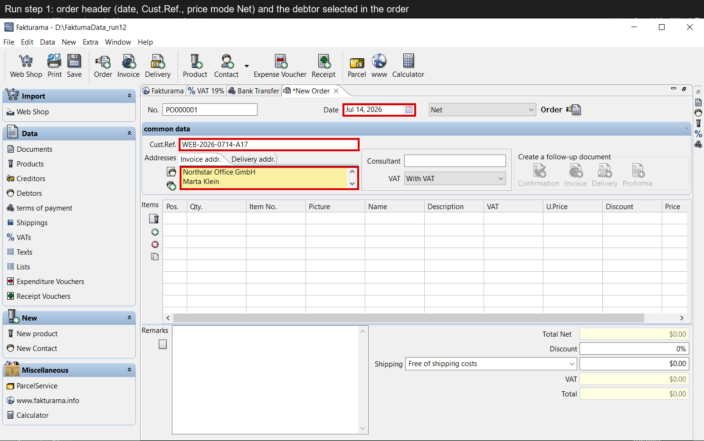
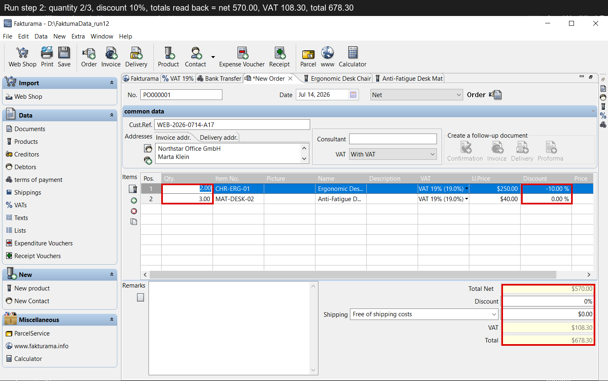
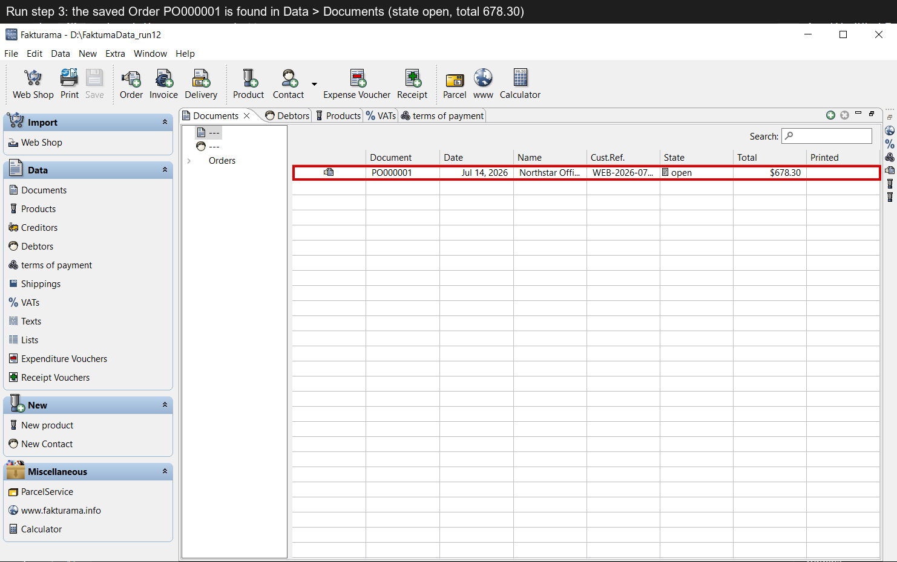
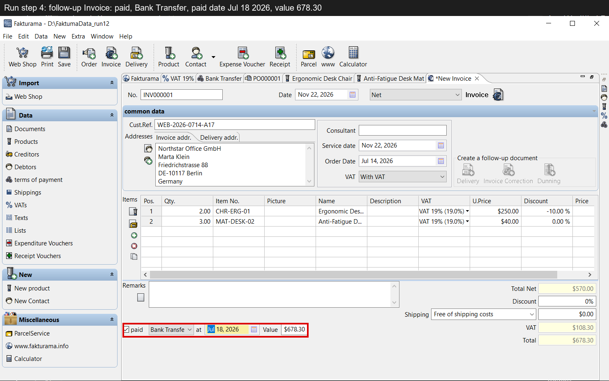
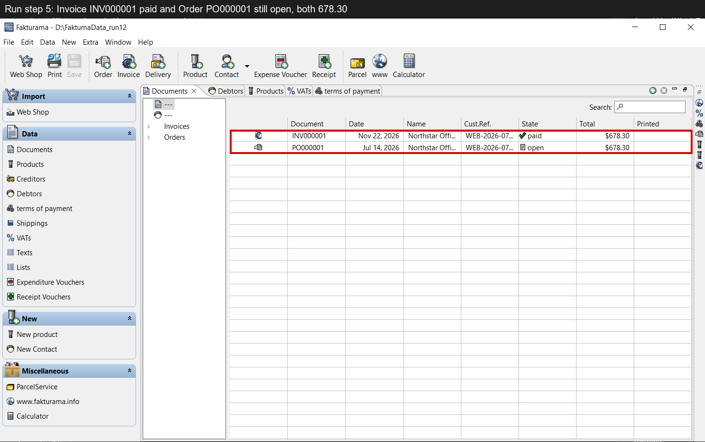

# Fakturama Image-to-Cash Automation

Take-home project for TJM Labs. A Python robot that reads an order image with a vision model, validates it, and drives the Fakturama desktop application through Microsoft UI Automation (UIA) from the image to a saved Order and a linked, paid Invoice, checking every step on screen.

**Status in one paragraph.** One command runs the whole chain on the task's example image: image to JSON, arithmetic validation, VAT and payment method, Order header, Debtor (created with a billing and a delivery address, reopened and compared), products, quantities and discounts, totals, the saved Order found in Data > Documents, the linked Invoice marked paid with date and value, and the Documents list showing both. It was run end to end on an empty Fakturama data folder and finished with every check green (Order PO000001 open, Invoice INV000001 paid, both 678.30). It is **not production-ready**: it is proven on that one example order, on one screen layout, and with known gaps listed below (for example the debtor's e-mail address does not persist in Fakturama and is reported as a warning, and a second run on a non-empty data folder is not supported).

The Part 1 design document is in [docs/Design_Doc_Fakturama.docx](docs/Design_Doc_Fakturama.docx).

## Screenshots (annotated, cropped to the Fakturama window)

Taken by the runner itself during the clean end-to-end run (`--shots`), then annotated with `tools/annotate_run_shots.py`.







There is no screen recording: the screenshots above are the evidence. The red "-10.00 %" in the Discount column is how Fakturama displays a 10 % discount that was typed as `10`; the line price and the totals confirm it is applied as a discount.

## Status

Step numbers refer to the task document.

| Step | Status |
|---|---|
| 1.1, 1.2 Read the order image into JSON (Gemini vision, fixed schema, model fallback) | Done: matches the answer key for the task's example image |
| Validate (line totals, sums, VAT, dates, payment rules), 15 unit tests | Done |
| 1.3 to 1.8 Open a New Order, Date, Cust.Ref., price mode Net, VAT mode | Done, read back on screen |
| 2.1 to 2.4 Select the Debtor from the Order (reads the dialog table, exact match, native row selection) | Done: the Invoice address box is verified; the Delivery address is not compared in the Order |
| 2.5 to 2.7, 2.9, 2.11 Create the Debtor (company, contact, billing address, alias, Net) | Done, record reopened and every field compared |
| 2.8 Address roles: Invoice role on the Main address, Delivery role or a second delivery address | Done, reopened and compared by role. The e-mail address does not persist for this two-address debtor; it is reported as a warning, not as verified |
| 2.10 Payment method (select or create) | Done with the mapped payment code (Bank Transfer = Credit transfer, Credit Card, SEPA Direct Debit) |
| 2.12, 2.13 Back to the Order and select the new Debtor | Done |
| 3.1, 3.17 Loop over every item | Done (the runner loops over the items of the image) |
| 3.2, 3.3 Select a Product from the Order by exact SKU (verified by Total Net and the Items grid, offline OCR fallback) | Done |
| 3.4 to 3.6 VAT (look up, create with code S) | Partly: reused by name only; the value and the code are not compared |
| 3.7 to 3.12 Create the Product (gross = net x (1 + VAT/100), cost 0, stock 0) and select it | Done |
| 3.13 to 3.16 Quantity, discount and line price on each order line | Done: cells edited, totals compared with the image (net 570.00, VAT 108.30, total 678.30) |
| 4.1 to 4.3 Confirm addresses, lines and totals against the image | Partly: totals and the address box are checked, the delivery address in the Order is not |
| 4.4 to 4.6 Save the Order, check Data > Documents | Done: one Order row with number, date, reference prefix, state open, total |
| 4.7 Create the linked Invoice | Done (follow-up button of the saved Order) |
| 5.1 to 5.6 Invoice: payment method, PAID date and value, save, verify | Done: paid ticked, Bank Transfer, date Jul 18 2026, value 678.30; Documents shows the Invoice as paid and the Order still open |
| Check before create | VAT, payment method and Debtor are looked up first; products are looked up by SKU. A run on a data folder that already holds documents is not supported |
| One-command runner and run report | Done: `python -m fakturama_bot.run` (report as JSON) |
| Annotated screenshots or a short recording | Annotated screenshots (above); no recording |

## Requirements

- Windows 10 or 11 and a 1920 x 1080 screen. Some positions inside the Items grid are measured at run time, but its row height is a fixed 25 px, and one setup helper (`tools/switch_workspace.py`) presses two dialog buttons at fixed screen positions.
- Fakturama 2.2.1 with the **English** user interface, open, main window not minimized, using a **new, empty data folder** (File > Select Workspace). Other programs may be open, the runner brings Fakturama back to the front, but do not use the computer during a run.
- Python 3.12.
- A Gemini API key (free tier works; it can answer 429 rate-limit errors, the runner waits and retries). Use synthetic data only: free-tier inputs may be used by the provider.

## Setup

```powershell
pip install -r requirements.txt
[Environment]::SetEnvironmentVariable("GEMINI_API_KEY", "<your key>", "User")   # then restart the terminal
```

Optional: `GEMINI_MODEL` puts your own model first. If the preferred model is overloaded, retired or stalls, the extractor tries the next one in `DEFAULT_MODELS` (`gemini-3.8-flash`, `gemini-3-flash-preview`, `gemini-3.1-flash-lite`) and logs which one answered.

## Run

From the project folder, with Fakturama open on an empty data folder:

```powershell
python -m fakturama_bot.run samples/task_example_order.png --shots docs/run_shots
```

It prints one line per stage (`ok`, `created`, `reused`, `STOP`), writes `run_output/run_report.json`, and stops with a screenshot at the first thing that does not match. `--json samples/task_example_order.expected.json` skips the AI reading and uses the answer key. A full run took about ten minutes, mostly waiting for the vision model.

Other commands:

```powershell
python -m unittest discover -s tests -t . -v                  # validator tests, no Fakturama and no key needed
python -m tools.try_extract samples/task_example_order.png    # reads the example image with Gemini and compares it to the answer key
python tools/switch_workspace.py D:\FaktumaData_new           # points Fakturama to a new empty data folder (restarts it)
```

The other scripts in `tools/` are the step-by-step scripts used during development (`try_*`); `tools/probes/` holds the look-only experiments. Their docstrings say what state they expect.

`samples/task_example_order.png` is the example order image from the task (synthetic data); `samples/task_example_order.expected.json` is its answer key.

## How it works

Layers that only communicate through one data object:

| Layer | File | Job |
|---|---|---|
| Extractor | `fakturama_bot/extract.py` | Image to JSON with a fixed schema; every field may be null so the model never has to invent a value |
| Validator | `fakturama_bot/validate.py` | Decimal arithmetic checks, date normalisation, stop on doubt |
| UI layer | `fakturama_bot/ui.py` | Find controls by name or label, write then read back, wait for conditions, no business logic |
| Vision | `fakturama_bot/vision.py` | Reads tables UIA cannot see: crop the screen, ask the vision model for the rows |
| Flow | `fakturama_bot/flow.py` | One function per business step, each ending with a check |
| Runner | `fakturama_bot/run.py` | The whole chain, the run report, screenshots, and a guard that keeps Fakturama in front |

Principles: names and labels instead of coordinates; write then read back; verify the outcome rather than the action; reopen saved records and compare; wait for conditions with a time limit; stop on doubt with a screenshot instead of guessing.

Findings that shaped the code:

- Forms and dropdowns are readable through UIA. The list tables (Debtors, VATs, Products, Documents, the address and product dialogs) and the Items table are custom-drawn and appear as anonymous panes.
- Simulated mouse clicks never selected a row in the selection dialogs. Sending the double-click as a window message to the table's native window (win32 backend) did.
- The opposite holds in the Items grid: typing into a cell only works after a **real** mouse click has put the focus in the cell editor. The code proves where the focus is (UIA focused element) before typing and compares the totals afterwards. The column positions are measured from the grid lines because they change with the window size.
- Fakturama did not keep a typed e-mail address although the form showed it, and it reorders the address tabs after saving. Saved records are therefore reopened and compared field by field, by address role.
- In a fresh data folder the editors open in a narrow pane, dialogs can open inactive when another program has the focus, and the vision model can misread a table that has an unnamed first column. Each of these stopped a run once and is handled (layout proof by tab position, bringing dialogs to the front, a prompt that ignores the extra column).
- The toolbar Save acts on the active panel, so the editor's own tab is activated before saving; a swallowed first press of Save is repeated.
- Typed text goes through pywinauto where `+`, `^`, `%`, `~`, `(`, `)`, `{`, `}` are commands, so they are escaped (a phone number `+49` was typed as `$9`).

## Limitations and skipped items

- Proven on one order only (the task's example) and one screen layout. Other images (photos, rotated, several pages, other languages, number formats) are untested.
- The data folder must be empty. A re-run on a folder that already holds the documents is not supported (the final Documents check expects exactly the Order and the Invoice of this run), and products and debtors are only found by SKU or by name and address.
- The debtor's e-mail address is typed but was not kept by Fakturama for this two-address debtor (the cause is not found; an earlier theory about `.example` addresses was not confirmed). It is reported as a warning, and the Order and the Invoice do not depend on it.
- VAT entries and payment methods that already exist are reused by name only (their value, code or settings are not compared). The delivery address is not compared in the Order after selecting the debtor.
- The Items grid uses a fixed row height (25 px) and assumes two or three lines, so the lines stay in the visible rows. The invoice's Date column shows the date of the day the invoice was made; the paid date (Jul 18 2026) is in the paid field.
- English user interface, 1920 x 1080 screen, and a free-tier Gemini key assumed. The vision read of tables sends a screenshot crop to the model, costs API calls and can time out or be rate limited; the runner waits and retries. Verification of an added product falls back to an offline Windows OCR (weaker: it checks that the SKU is present, not which row). With real customer data this needs a private or paid model.
- Company names in the address dialog are cut off by the column width, so they are matched by prefix and verified in full in the Order afterwards.
- The Fakturama version used here has the Payment dropdown on the Miscellaneous tab of the Debtor editor and fills it when the editor opens, so the payment method is created before the Debtor form is opened (the task creates it while the Debtor editor is open).
- Switching to a new data folder (`tools/switch_workspace.py`) uses two fixed screen positions because the folder dialog is not reachable through UIA. It is a setup helper, not part of the order flow.
- No screen recording; annotated screenshots instead.

## If you had 3 more hours, what would you do?

1. Make re-runs safe: look at what Data > Documents, Debtors and Products already hold, reuse it, and report created / reused / skipped; compare the value and code of an existing VAT entry and the debtor's delivery address in the Order.
2. Find why the debtor's e-mail address does not persist (an application setting, a field rule or a bug) and either fix the input or document the rule.
3. Make the Items grid layout-independent: measure the row height and the visible rows, scroll when an order has more lines than fit, and handle a missing discount or several pages.
4. Test harder orders: rotated or blurred photos, German number format, several pages, an unknown payment method, a customer that already exists with a different address.
5. Cut the run time: read each table once, cache what was read, and reduce vision calls with a cheaper offline check where it is reliable (the current run is about ten minutes, mostly waiting for the vision model).
6. Add a review queue: when the bot stops, save the extracted data and a screenshot so a person can fix it and resume instead of restarting, and add an end-to-end test on a clean Fakturama database in CI.

## Repository layout

```
fakturama_bot/   extract.py, validate.py, ui.py, vision.py, flow.py, run.py
tests/           unit tests for the validator and the task example
samples/         the task's example order image and its answer key
tools/           try_* scripts (one stage each, for debugging), helpers (switch_workspace, annotate_run_shots, inspect_ui)
tools/probes/    look-only experiments and raw UIA dumps used to learn how Fakturama behaves (run from the project root with PYTHONPATH=.)
docs/            Part 1 design document, annotated screenshots (docs/annotated)
```
